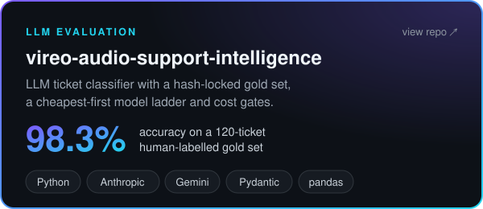
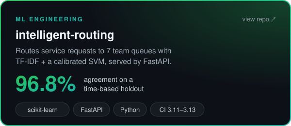
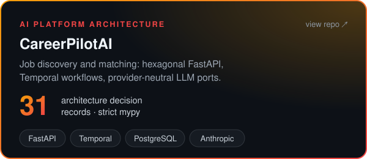
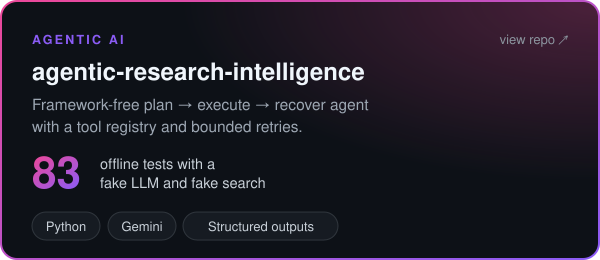
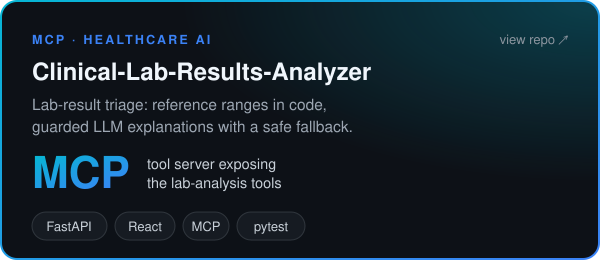
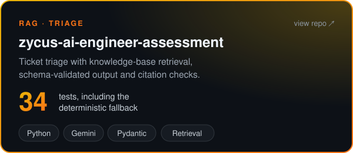
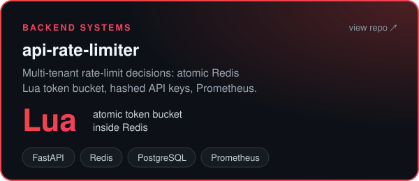
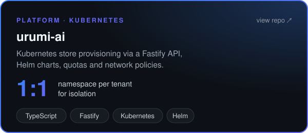
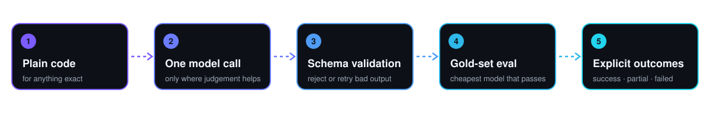

  

  
  
  

I build AI applications the way I would want to operate them: **plain code where the answer must be exact,
a model only where judgement is needed**, outputs validated against a schema, quality measured on labelled data,
and failures reported explicitly instead of hidden behind a confident answer.

## 🚀 Featured AI & LLM systems

<table>
  <tr>
    <td width="50%"></td>
    <td width="50%"></td>
  </tr>
  <tr>
    <td width="50%"></td>
    <td width="50%"></td>
  </tr>
  <tr>
    <td width="50%"></td>
    <td width="50%"></td>
  </tr>
</table>

Metrics come from each repository's own README and test suite. vireo and intelligent-routing were evaluated on private assessment data, so those numbers are as reported, not reproducible from a public clone. Clinical-Lab is educational, not diagnostic.

## ⚙️ Backend & platform engineering

<table>
  <tr>
    <td width="50%"></td>
    <td width="50%"></td>
  </tr>
</table>

## 🧭 How I build AI systems

  

- **Deterministic first.** In vireo the model makes one judgement per ticket; dates, costs and joins are ordinary code with assertions.
- **Validated outputs.** Model responses are parsed into Pydantic schemas and rejected or retried when they do not fit.
- **Measured before rollout.** Models are scored on gold data cheapest-first, and the cheapest one that passes is used.
- **Honest failure states.** Agents and pipelines return `partial` or `failed`, or fall back to rules, rather than inventing an answer.

## 🛠️ Tech I have used in these projects

| | |
|---|---|
| **LLMs & agents** |      |
| **ML & data** |    |
| **Backend** |      |
| **Infra & tooling** |       |

## 🔭 Currently

Adding evaluation to CareerPilotAI's matching, and making my main projects reproducible from a clean clone with synthetic data.
